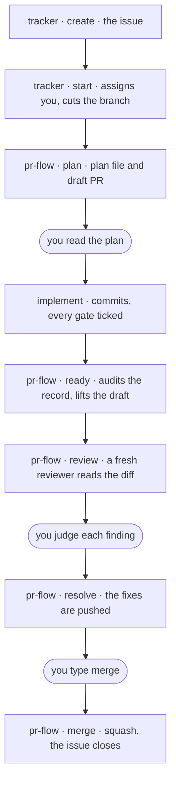
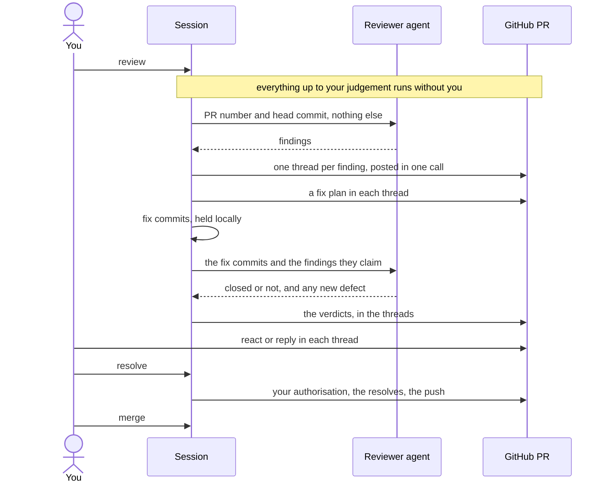
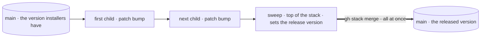
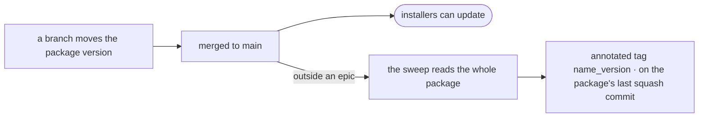
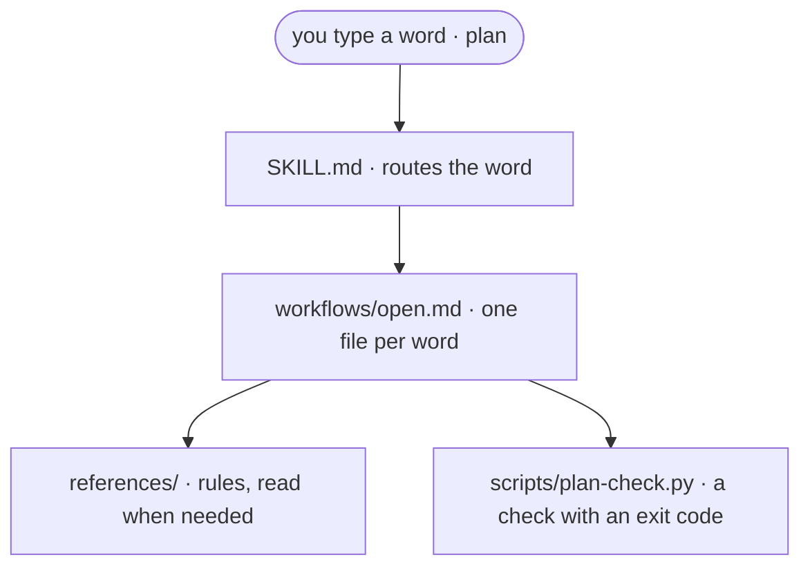

> 🤖 Written by AI --- read/modified by izkreny! 🤓

# A walkthrough of agentifico

This page shows how the repository works at a high level. Each diagram names a step by the word you type to start it. The detail behind each step lives in the package's own README, linked under each diagram. How each package reaches you is in the [root README](../README.md).

## The loop, from idea to merge

gh-solo runs the whole life of one change. One issue becomes one branch and one pull request. The rounded steps are yours, and the agent never does them for you.

`go` runs implement, ready and review back to back once you have read the plan, and stops where you judge the findings. `auto` does the same from the issue, without waiting for you to read the plan.

More detail: [tracker](../plugins/gh-solo/skills/tracker/README.md), [pr-flow](../plugins/gh-solo/skills/pr-flow/README.md), [implement](../plugins/gh-solo/skills/implement/README.md).

## The review round

The code is never reviewed by the session that wrote it. A `reviewer` agent gets the pull request number and the commit to read, and nothing else. Every finding becomes a thread on the exact line it concerns. Fixes are committed but held until you say so.

More detail: [the review protocol](../plugins/gh-solo/skills/pr-flow/references/review-protocol.md).

## An epic ships as a stack

An epic's children are stacked branches, each built on the one below. Each child moves its package's version by a patch only. The top branch is the sweep, a review of the whole package, and it sets the release version. `gh stack merge` lands the whole stack at once, so nobody can install a version from the middle of it.

Work outside an epic is not stacked. It goes straight from its branch to `main`.

More detail: *A stack is the release train* in [AGENTS.md](../AGENTS.md).

## How a package is released

A package's version field is its release. When a version bump reaches `main`, everyone who installed the package can update to it. The tag comes later, by hand, and only after the package's sweep has read it whole.

Inside an epic, the sweep is the stack's top branch, so it runs before the merge, as the diagram above shows.

More detail: *How a package is released* in [AGENTS.md](../AGENTS.md).

## How a skill is built

A skill here is a small program written in prose. Its skill file only routes: it reads the word you typed and opens one workflow file for that word. The workflow reads references when it needs a rule, and runs scripts for anything a script can check.

The example is [`plugins/gh-solo/skills/pr-flow/SKILL.md`](../plugins/gh-solo/skills/pr-flow/SKILL.md). The [agents-guru](../skills/agents-guru/README.md) skill holds the rules every skill here is written and checked against.
